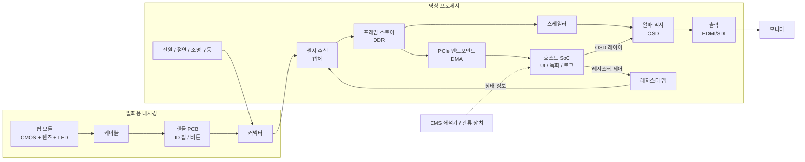

# 일회용 신장내시경(Nephroscope) 시스템 구현 기획서

> **문서 성격**: 공개 정보와 일반적인 의료용 내시경 설계 지식으로 재구성한 **가상 기획서(초안 v0.1)**입니다.
> 다인메디컬그룹과 EMS의 실제 설계 사양은 공개되어 있지 않으므로, 수치와 구조는 모두 **가정(A)**이며 검증·확정이 필요합니다.
> 시장성과 보도의 신빙성은 범위에서 제외하고 **구현(설계·검증·인허가 산출물·일정)**에 집중합니다.

---

## 0. 표기 규칙과 전제

| 표기 | 의미 |
|---|---|
| **[공개]** | 보도·공개 DB로 확인된 사실 |
| **[가정]** | 설계상 합리적으로 세운 값. 확정 전까지 변경 가능 |
| **[확인필요]** | 제조사(EMS/다인)만 알 수 있는 항목 |

**[공개] 전제 사실**
- 대상 제품은 PCNL(경피적 신절석술)에 쓰는 차세대 신장내시경 시스템이며, 2027년 출시 목표로 최종 개발 단계에 있다고 알려져 있음.
- EMS는 Swiss LithoClast 계열 쇄석기를 제조함. 해당 일회용 초음파 프로브는 외경 3.4~3.9mm급 제품이 공개 DB(AccessGUDID)에 등재되어 있음.
- 다인메디컬의 기존 제품 우루스는 일회용 연성 요관경이며 작업채널을 6시 방향에 둔 구조임. 제품군에는 비디오 프로세서와 디스플레이 유닛이 있음.
- 채용 JD의 FPGA 업무(영상 캡처, 프레임 스토어, 스케일러, 알파 믹서, DDR, PCIe/DMA, CDC)는 비디오 프로세서 개발 범위로 해석됨 [가정].

---

## 1. 제품 정의

### 1.1 목적
PCNL 시술에서 신장 내 결석을 직접 보며 쇄석·흡인할 수 있는 **일회용 내시경 + 영상 프로세서** 통합 시스템을 구현한다.

### 1.2 사용 시나리오 [가정]
1. 환자 자세(복와위 또는 앙와위)를 잡고 경피적으로 신장 접근로(tract)를 확보한다.
2. 접근 시스(sheath, 흡인형 시스 포함)를 통해 일회용 내시경을 삽입한다.
3. 작업채널로 EMS 쇄석 프로브(초음파/공압)를 통과시켜 결석을 분쇄한다.
4. 관류액과 흡인으로 시야를 유지하고 파편을 배출한다.
5. 필요 시 바스켓·겸자·레이저 파이버 등 보조 기구로 잔석을 제거한다.
6. 시술 후 내시경은 폐기한다. 프로세서와 모니터는 재사용한다.

### 1.3 시스템 경계

| 구분 | 포함 | 비고 |
|---|---|---|
| 일회용부 | 내시경 본체(삽입부, 핸들, 팁 모듈, 케이블, 커넥터) | 멸균 공급, 1회 사용 |
| 재사용부 | 영상 프로세서(FPGA+호스트), 디스플레이 연결, 전원 | 의료기기 전기안전 대상 |
| 연동부 | EMS 쇄석기, 관류·흡인 장치 | 물리 결합 또는 정보 표시 연동 [확인필요] |

---

## 2. 시스템 아키텍처

### 2.1 설계 원칙
1. **안전 우선**: 영상 끊김·정지 시 시술 중단 위험이 있으므로 복구 시퀀스를 설계 단계에서 확정한다.
2. **저지연**: 센서→모니터 지연을 정량 요구사항으로 두고 계측한다. 목표값은 3.2절(E-03)에 둔다.
3. **일회용 단가 관리**: 일회용부의 부품·공정 수를 최소화하고 지능(처리, 보정)은 재사용부로 옮긴다.
4. **검증 가능한 구조**: 블록 경계마다 관측 지점(어서션, 카운터, 테스트 핀)을 둔다.

---

## 3. 요구사항 초안

### 3.1 기구·광학 [가정]

| ID | 항목 | 목표(가정) | 검증 방법 |
|---|---|---|---|
| M-01 | 작업채널 내경 | EMS 프로브 외경 + 여유(≥ 약 4.2mm 검토) [확인필요] | 프로브 통과·왕복 시험 |
| M-02 | 삽입부 외경 | 사용 시스 규격(예: 흡인형 시스 14~22Fr 범위 호환 검토) 내 | 치수 측정, 시스 삽입 시험 |
| M-03 | 삽입부 유효 길이 | 임상 요구 확정 후 결정 [확인필요] | 치수 측정 |
| M-04 | 굴곡 | 직선형, 반강성, 연성 중 확정 필요. 연성이면 양방향 굴곡각 목표 설정 | 굴곡각·반복 굴곡 시험 |
| M-05 | 관류·흡인 채널 | 목표 유량·압력에서 시야 유지 | 유량·압력 측정 |
| O-01 | 시야각, 피사계심도 | 근거리(수 mm)~원거리 초점 유지 | 해상력 차트(USAF 등) |
| O-02 | 팁 온도 | 장시간 사용 시 조직 접촉 허용 온도 이내 | 열 측정(생리식염수 조건) |
| O-03 | 김서림·결로 | 시술 온도 변화에서 방지 | 환경 시험 |

### 3.2 전자·영상 [가정]

| ID | 항목 | 목표(가정) | 검증 방법 |
|---|---|---|---|
| E-01 | 센서 입력 | 초소형 CMOS. 해상도와 인터페이스(LVDS/MIPI/아날로그)는 센서 선정 후 확정 | 센서 평가 보드 |
| E-02 | 출력 | 1080p60 기준 HDMI(및 SDI 검토) | 출력 타이밍 계측 |
| E-03 | 종단 지연 | 센서→모니터 약 100ms 이하를 초기 목표(임상 요구에 맞춰 조정) | 계측(4.4.4절) |
| E-04 | 프레임 안정 | 언더런·티어링 0건(연속 시험 기준 설정) | 장시간 시험 |
| E-05 | 복구 | 케이블 탈착·링크 리셋·호스트 재부팅 후 자동 복구, 복구 시간 상한 설정 | 이상 주입 시험 |
| E-06 | 환자 접촉부 안전 | 전기 절연·누설전류 규격 충족 | 전기안전 시험 |
| E-07 | 전자파 | 방출·내성 규격 충족, 쇄석기·전기수술기와 동시 사용 시 영상 유지 | EMC 시험 |

### 3.3 소프트웨어 [가정]

| ID | 항목 | 목표(가정) |
|---|---|---|
| S-01 | OSD | 상태, 경고, 사용자 설정 표시 |
| S-02 | 영상 조정 | 밝기, 화이트밸런스, 노출 제어 |
| S-03 | 캡처·녹화 | 정지 영상, 동영상 저장 |
| S-04 | 일회용 인식 | 커넥터 ID 인증, 사용 이력 관리 |
| S-05 | 로그 | 사건·오류 기록(분석·인허가 근거) |
| S-06 | 업데이트 | 서명 검증된 펌웨어 업데이트 |

---

## 4. 서브시스템 설계

### 4.1 기구

- **구조**: 삽입부(샤프트) → 핸들(조작부, 포트) → 연결 케이블.
- **핵심 설계 이슈**
  - 작업채널 크기는 EMS 프로브 외경과 직결되어 샤프트 외경·굴곡성과 서로 상충한다. 초음파 프로브를 쓰려면 직선 또는 반강성 구조가 유리하고, 굴곡을 우선하면 다른 쇄석 수단(레이저 파이버 등)과의 조합이 필요하다. 어느 쪽인지는 [확인필요].
  - 6시 방향 작업채널(우루스에서 사용)을 유지할지 결정한다. 시야 사각 감소 이점이 있다.
  - 흡인형 PCNL에서는 흡인 경로와 채널 간 유로 간섭을 피해야 한다.
- **재질·공정**: 사출 부품(핸들), 압출 튜브(샤프트), 와이어 굴곡 구동(연성형), 접착·씰링. EO 멸균 호환 소재 선정.
- **시험**: 굽힘 반복, 압축·인장, 누수, 채널 마찰, 프로브 통과 반복.

### 4.2 광학·조명

- **구성**: 팁 CMOS 모듈, 렌즈 스택, LED(팁 장착) 또는 광섬유 조명.
- **결정 사항**: 센서 크기 대비 해상도, 시야각, 초점 거리, 조명 광량과 발열 균형.
- **시험**: 해상력, 조도 균일성, 색 재현, 왜곡, 팁 온도.

### 4.3 팁 센서와 일회용 전자

- 팁 → 케이블 → 핸들 PCB → 커넥터로 신호를 전달한다. 케이블 길이·굴곡 환경에서 신호 무결성이 핵심 위험이다.
- 핸들 PCB: 버튼 입력, ID 칩, 필요 시 신호 재구동(리타이머).
- 일회용부는 최소 부품으로 유지하고 영상 보정은 프로세서에서 수행한다.
- 일회용 커넥터: 접촉 신뢰성, 방수, 정전기 방전(ESD) 보호.

### 4.4 영상 프로세서 (FPGA) — JD와 직접 대응

#### 4.4.1 블록 구성

| 블록 | 기능 | 설계 포인트 |
|---|---|---|
| 센서 수신 | 센서 인터페이스 수신, 동기, 비정상 프레임 감지 | 불규칙 프레임 타이밍 허용, 링크 손실 감지 |
| 캡처·프레임 스토어 | DDR에 프레임 기록 | 더블/트리플 버퍼, 버퍼 소유권 불변식 |
| 스케일러 | 센서 해상도→출력 해상도 | 라인버퍼 스케일러, 필터 품질 |
| 알파 믹서 | 영상 + OSD 합성 | OSD 레이어 별도 버퍼, 원자적 전환 |
| 출력 생성 | 디스플레이 raster 타이밍 | 센서 클럭과 출력 클럭 비동기 처리 |
| DDR 서브시스템 | 컨트롤러 IP, 다중 마스터 중재 | 대역폭 예산과 실측 |
| PCIe EP + DMA | 호스트로 영상 전달 | 하드 IP 또는 상용 DMA IP 선택, 타임아웃·오류 복구 |
| 레지스터·진단 | 제어, 상태, 카운터 | SW와 인터페이스 규격 합의 |

#### 4.4.2 DDR 대역폭 예산 (예시 계산, 가정)

가정: 센서 입력 1280×720@60, YUV422(16bpp) / 출력 1080p60 / OSD 960×540 ARGB(4B)@60 / 호스트 DMA는 720p60 전송.

| 마스터 | 계산 | 대역폭 |
|---|---|---|
| 캡처 기록 | 1280×720×2B×60 | 약 110.6 MB/s |
| 스케일러 읽기 | 동일 | 약 110.6 MB/s |
| OSD 읽기 | 960×540×4B×60 | 약 124.4 MB/s |
| DMA 읽기 | 1280×720×2B×60 | 약 110.6 MB/s |
| **합계** | | **약 456 MB/s** |

여유율 2배를 적용하면 약 0.9 GB/s가 필요하다. DDR3 16비트(800MT/s급)는 이론 약 1.6 GB/s이며 효율을 70%로 보면 약 1.1 GB/s이므로 **여유가 크지 않다**. 해상도·OSD 크기·다중 버퍼 수에 따라 달라지므로 확정 사양에서 재계산한다. 실측으로 반드시 확인한다.

#### 4.4.3 클럭 도메인 (CDC) 목록 [가정]

| 도메인 | 용도 | 크로싱 방식 |
|---|---|---|
| 센서 픽셀 클럭 | 입력 수신 | 비동기 FIFO |
| DDR 사용자 클럭 | 컨트롤러 인터페이스 | AXI 비동기 브리지 |
| 출력 픽셀 클럭 | 디스플레이 생성 | 비동기 FIFO, 프레임 전환 핸드셰이크 |
| PCIe 사용자 클럭 | DMA, 레지스터 | 비동기 FIFO, 핸드셰이크 |
| 레지스터·관리 클럭 | 제어 | 동기화 체인 또는 핸드셰이크 |

각 크로싱은 문서에 근거(방식 선택 이유)와 정적 CDC 도구 결과를 함께 남긴다.

#### 4.4.4 지연 계측 방법
센서 프레임 시작 시점의 타임스탬프를 영상에 심어(또는 외부 트리거 핀 사용) 출력 프레임 시작 시점과 비교한다. 광학적 계측(LED 점멸과 포토다이오드 + 오실로스코프)으로 종단 지연을 교차 확인한다.

#### 4.4.5 복구 시퀀스 개요
1. 센서 링크 손실 감지 → 마지막 정상 프레임 유지 + 경고 OSD.
2. 링크 재수립 → 센서 재초기화 → 프레임 동기 재획득.
3. PCIe 링크 리셋 → 호스트 재부팅 후에도 출력은 독립 유지(영상 경로를 호스트에 종속시키지 않음).
4. 타임아웃 상한 초과 시 오류 코드 기록.

### 4.5 호스트 소프트웨어

- 구성: 임베디드 OS 또는 RTOS, UI/OSD 엔진, 녹화, 로그, 업데이트.
- FPGA와의 인터페이스: 레지스터 맵 규격서 기반. 메모리 매핑과 인터럽트 정의.
- 소프트웨어 수명주기는 IEC 62304 안전 등급(초안은 B 검토 [가정])에 맞춰 관리한다.
- 사이버보안: 업데이트 서명, 로그 보호, 불필요 포트 차단.

### 4.6 유체·쇄석기 연동 [확인필요]

- 연동 수준은 세 가지 후보가 있다. (1) 물리 호환만(프로브 통과), (2) 상태 정보 표시(OSD에 쇄석기·관류 정보 표시), (3) 제어 연동.
- 신장 내압 관리가 안전 쟁점이므로 관류·흡인 조건을 시험 기준으로 포함한다.

### 4.7 일회용 인식과 사용 관리

- 커넥터 ID 칩으로 정품·모델·사용 이력을 인식하고 재사용을 차단한다.
- 정보는 프로세서 로그에 기록해 추적성(lot, 제조일)을 확보한다.

### 4.8 멸균·포장

- EO 멸균, 포장 무결성, 유효기간(가속 노화 시험), 라벨·UDI.
- 소재·접착부의 EO 잔류물, 전자 부품 신뢰성을 함께 평가한다.

---

## 5. 인터페이스 정의

| 인터페이스 | 양단 | 규격 항목 |
|---|---|---|
| IF-1 | 팁 모듈 ↔ 핸들 PCB | 신호, 전원, 길이, 굴곡 조건 |
| IF-2 | 핸들 ↔ 커넥터 ↔ 프로세서 | 핀맵, 절연, ESD, 접촉 신뢰성 |
| IF-3 | 센서 ↔ FPGA | 프로토콜, 타이밍, 초기화 시퀀스 |
| IF-4 | FPGA ↔ DDR | 컨트롤러 설정, 중재 정책 |
| IF-5 | FPGA ↔ 호스트(PCIe) | BAR 맵, DMA 디스크립터, 오류 처리 |
| IF-6 | FPGA ↔ 모니터 | HDMI/SDI 타이밍, EDID |
| IF-7 | 호스트 ↔ EMS 장치 | 프로토콜 [확인필요] |

각 IF는 규격서, 소유자, 변경 절차를 갖는다.

---

## 6. 검증 계획

### 6.1 FPGA 검증 전략 (실용적 접근)
대규모 UVM 대신 **위험도가 높은 지점을 선별**해 어서션과 표적 테스트벤치로 확인한다.

| 단계 | 내용 |
|---|---|
| 검증 계획 | 기능·성능·오류 처리 항목의 우선순위와 커버리지 범위 정의 |
| 시뮬레이션 | 불규칙 프레임 타이밍을 포함한 센서 모델, DDR/호스트 모델 |
| 어서션 | 버퍼 소유권 불변식, 프로토콜 준수, 언더런 방지 조건 |
| CDC 검증 | 정적·형식 검증, 예외 항목은 근거와 함께 승인 |
| 하드웨어 | 장시간 연속 동작, 모드 전환, 링크 리셋, 호스트 재부팅 복구, 입력 이상 주입 |
| 계측 | 지연·안정성 정량 계측 결과 보고 |

### 6.2 시스템 수준 검증

| 영역 | 시험 |
|---|---|
| 기구 | 굴곡 반복, 프로브 통과, 누수, 유량·흡인 |
| 광학 | 해상력, 조도, 색, 팁 온도 |
| 전기 | 누설전류, 절연, EMC, 쇄석기 동시 사용 시 영상 유지 |
| 소프트웨어 | 단위·통합·회귀, 오류 주입 |
| 환경 | 온습도, 운송, 가속 노화 |
| 모의 시술 | 3D 모형·돼지 신장 등 비임상 모델에서 시술성 확인 |

---

## 7. 규격과 설계 산출물

### 7.1 적용 검토 규격 (확정 전)

| 영역 | 규격 | 비고 |
|---|---|---|
| 품질경영 | ISO 13485 | 설계관리 필수 |
| 위험관리 | ISO 14971 | FMEA와 연계 |
| 전기안전 | IEC 60601-1 | 환자 접촉부 분류 [확인필요] |
| 전자파 | IEC 60601-1-2 | |
| 내시경 기기 | IEC 60601-2-18, ISO 8600 계열 | |
| 소프트웨어 | IEC 62304 | |
| 사용적합성 | IEC 62366-1 | |
| 생체적합성 | ISO 10993 | 접촉 부위·시간 분류 |
| 멸균 | ISO 11135(EO) 등 | |
| 인허가 | FDA 510(k), 유럽 MDR, 식약처 | 법적 제조자 구조에 따라 달라짐 [확인필요] |

### 7.2 문서 체계 (JD의 문서화 업무 반영)

- 설계 명세서, 인터페이스 규격서, 레지스터 명세서
- 설계 판단 근거 기록(대안과 선택 이유)
- 검증 절차서와 결과 보고서(설계검증 산출물 요건 반영)
- 위험관리 파일, 추적성 매트릭스(요구사항 ↔ 설계 ↔ 시험)

---

## 8. 작업분해(WBS)와 일정

기준: 상대 개월(M). 이미 최종 개발 단계이므로 **전체 재현 시 기준**이며, 실제 일정은 현재 단계에 맞춰 조정한다.

| 단계 | 주요 작업 | 기간(가정) | 산출물 |
|---|---|---|---|
| P0 | 요구사항 확정, EMS 연동 범위 확정, 벤치마크 분석 | M0~M2 | 요구사항서, 선행기기 비교표 |
| P1 | 아키텍처·개념 설계, 부품 선정, 위험분석 시작 | M2~M5 | 설계 개념서, DFMEA 초안 |
| P2 | 시제품(EVT): 기구, 팁 모듈, 프로세서 보드, FPGA 1차 | M5~M10 | EVT 샘플, 브링업 보고서 |
| P3 | 설계 검증(DVT): 성능·EMC·안전 사전 시험, FPGA 검증 완료 | M10~M15 | 검증 보고서 |
| P4 | 모의 시술, 사용적합성, 설계 동결 | M13~M17 | 사용적합성 보고서 |
| P5 | 양산 이관(PVT), 멸균·포장 밸리데이션 | M15~M20 | 공정 밸리데이션 |
| P6 | 인허가 제출·심사 대응 | M17~M24 | 기술문서 |
| P7 | 출시 준비, 공급 램프업 | M22~ | 출하 시험 기준 |

### 8.1 마일스톤 게이트

| 게이트 | 통과 조건 |
|---|---|
| G1 설계 입력 동결 | 요구사항·인터페이스 합의 |
| G2 EVT 완료 | 영상 경로 종단 동작, 기구 프로브 통과 확인 |
| G3 설계 검증 완료 | 필수 시험 합격, 중대 이슈 해결 |
| G4 설계 동결 | 사용적합성 반영, 변경관리 개시 |
| G5 양산 승인 | 밸리데이션 완료, 공급 품질 합의 |

---

## 9. 주요 위험과 대응

| 위험 | 영향 | 대응 |
|---|---|---|
| 작업채널 크기와 굴곡성 상충 | 시술 성능 | 초기에 프로브 통과 시험을 포함한 기구 시제품으로 검증 |
| 케이블 길이·굴곡에서 신호 열화 | 영상 불량 | 센서 인터페이스 선정 시 마진 확보, 조기 시험 |
| 팁 발열 | 안전 | 조명 구동 제어, 온도 시험 조기 수행 |
| DDR 대역폭 부족 | 프레임 손실 | 예산 계산 후 실측, 해상도·버퍼 수 조정 |
| 호스트 재부팅 시 영상 끊김 | 시술 중단 | 영상 경로를 호스트에서 독립시킴 |
| 쇄석기 EMC 간섭 | 영상 노이즈 | 차폐·접지 설계, EMC 사전 시험 |
| 인허가 법적 제조자 불명확 | 일정 지연 | 계약 단계에서 책임 범위 확정 |
| EMS 요구사항 변경 | 재설계 | 변경관리, 인터페이스 규격 동결 시점 합의 |
| 일회용 단가 초과 | 사업 구조 | 일회용부 BOM 목표 설정, 공정 단순화 |

---

## 10. 미확정 항목 (확인필요 목록)

1. 내시경 형태: 직선·반강성·연성 중 무엇인가, 작업채널 내경은 얼마인가.
2. 센서 종류, 해상도, 인터페이스.
3. 영상 프로세서의 구성: FPGA 외 호스트 SoC 구성, PCIe 연결 대상.
4. EMS 쇄석기·관류 장치와의 연동 수준(물리/정보/제어).
5. 인허가 주체(법적 제조자)와 시장별 경로.
6. 환자 접촉부 안전 분류와 적용 규격 범위.
7. 일회용 재사용 방지 방식.

---

## 부록 A. 나무 님 관점의 적용 지점 (자문 범위 후보)

JD와 겹치는 영역 중 모듈 단위로 분리 가능한 항목입니다.

- FPGA 검증 계획 수립과 어서션·CDC 검증 체계
- 영상 파이프라인 설계 리뷰와 DDR 대역폭 예산 검증
- 브링업 지원과 지연·안정성 계측
- 설계 명세·레지스터 명세·검증 보고서 문서 체계

## 부록 B. 개정 이력

| 버전 | 내용 |
|---|---|
| v0.1 | 공개 정보 기반 가상 기획 초안 |
